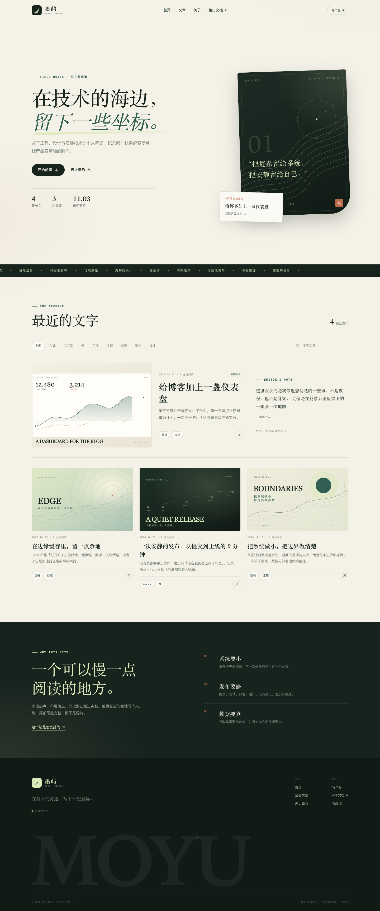
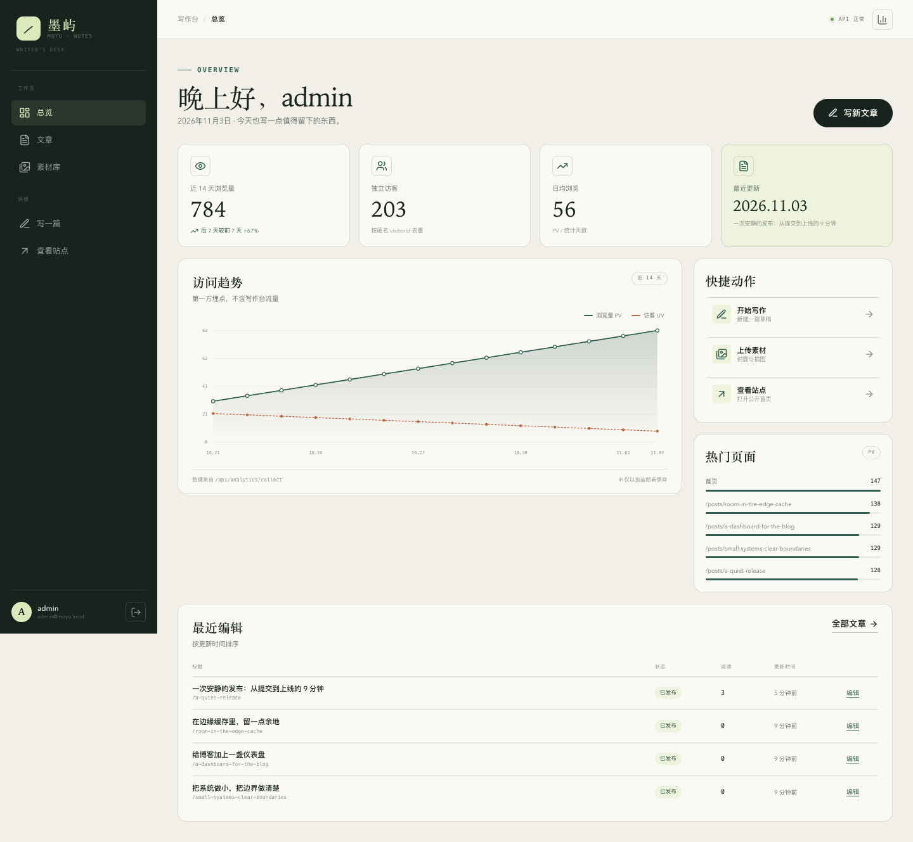
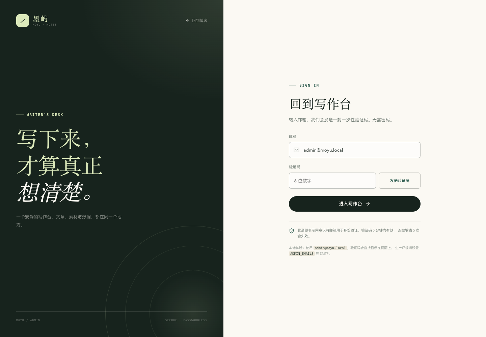
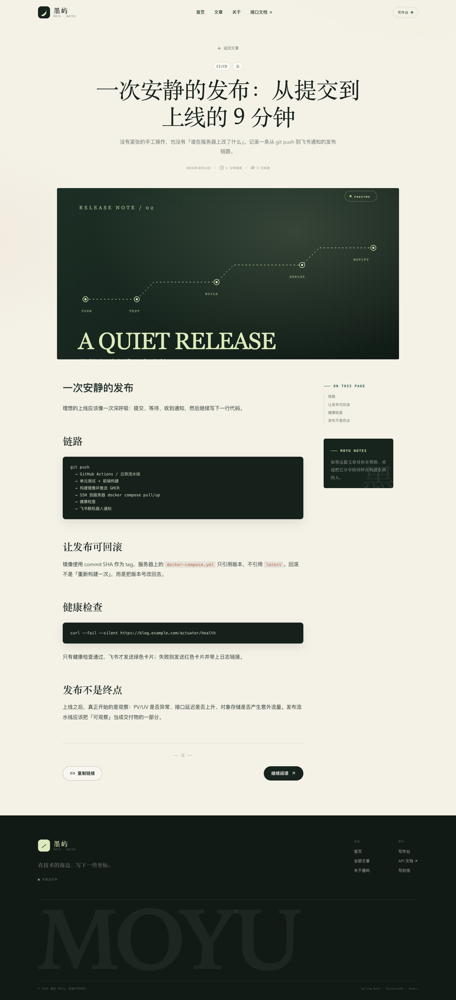
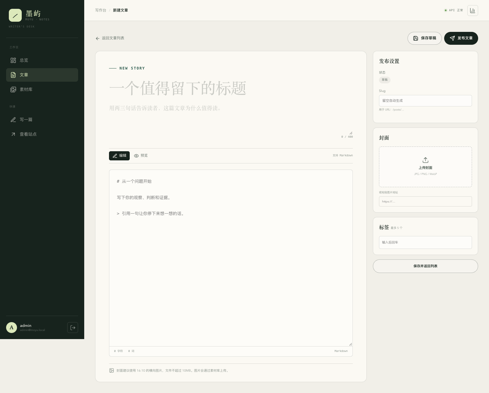

# 墨屿 MOYU

一个**可以真正上线**的个人博客：公开站点 + 写作后台 + Spring Boot API + PostgreSQL，外加域名、HTTPS、CDN、腾讯云 COS、Swagger、极验、邮箱验证码、GitHub Actions、阿里云云效、飞书通知和 PV/UV 埋点。

它不是只给你一张架构图。仓库里已经包含可运行代码、数据库迁移、自动化测试、Docker 镜像、Caddy 自动 HTTPS、GitHub 工作流，以及一份**没有服务器也能上线**的云服务路线。



## 需求对照

| 你提到的能力 | 在项目里的实现 |
| --- | --- |
| 前端 + 后台 + 后端 | React 19 + Vite 前台与后台；Spring Boot 3.5 + Java 21 API |
| 数据库 | PostgreSQL 18（本地）/ 17（Docker），Flyway 管理迁移 |
| 域名、SSL | Caddy 自动申请与续期 Let's Encrypt；Cloudflare 负责 DNS / 边缘证书 |
| CDN | Cloudflare 代理与缓存规则；腾讯云 COS + CDN 自定义域名 |
| 文件上传 / 海量存储 | 管理后台拖拽上传；本地磁盘与腾讯云 COS 双实现，可切换 |
| Swagger 接口文档 | SpringDoc，`/swagger-ui.html` |
| 登录 | 邮箱一次性验证码 + JWT；极验 v4 人机校验；限流与防爆破 |
| CI/CD | GitHub Actions：测试 → 镜像 → SSH 部署 → 健康检查；阿里云云效 YAML 示例 |
| 飞书通知 | 部署成功/失败卡片，包含提交、镜像、流水线链接 |
| 百度统计 PV/UV | 前端脚本接入百度统计；同时把 PV/UV 落到自己的 PostgreSQL |
| Java Spring + PostgreSQL | 后端与数据库选型完全匹配 |

## 界面预览

| 写作台总览 | 登录 |
| --- | --- |
|  |  |

| 文章页 | 编辑器 |
| --- | --- |
|  |  |

## 本地跑起来（只有前端环境也可以）

需要 Node.js 22+ 与 pnpm 10。JDK、Maven、PostgreSQL 会下载到项目内的 `.tools/`，**不修改系统环境**。

```bash
# 没有 pnpm 的话：npm install -g pnpm@10
./scripts/setup-local.sh   # 首次：下载 JDK 21 + Maven + PostgreSQL 18，安装前端依赖
./scripts/dev.sh           # 一键启动数据库、API、前端
```

打开：

| 地址 | 用途 |
| --- | --- |
| http://127.0.0.1:5173 | 公开博客 |
| http://127.0.0.1:5173/admin | 写作后台 |
| http://127.0.0.1:8080/swagger-ui.html | Swagger 接口文档 |
| http://127.0.0.1:8080/actuator/health | 健康检查 |

本地默认管理员：`admin@moyu.local`。开发模式不会真的发邮件，验证码会直接显示在登录页，也会打印在 API 日志里。生产环境把 `EXPOSE_DEV_CODE` 设为 `false`、`MAIL_MODE` 设为 `smtp`。

### 用 Docker 跑

```bash
cp .env.example .env
docker compose up -d --build
```

访问 http://localhost:8088 。数据库、上传目录都在 Docker volume 中。

### 三分钟体验路径

1. 打开 `/admin`，用 `admin@moyu.local` 获取验证码并登录。
2. 在「文章」里新建一篇，写标题、摘要、Markdown 正文，上传封面，发布。
3. 回首页，点进文章；打开后台「总览」，能看到 PV/UV、热门页面。
4. 打开 Swagger，用登录返回的 JWT 调一次 `/api/admin/posts`。
5. 想看图好看一点，可以运行 `./scripts/seed-demo-traffic.sh --yes`（**仅本地演示**，会清空 `page_views`）。

> 当前截图中的 784 PV / 203 UV 来自这个演示脚本，不是真实访问数据。

## 技术栈

| 层 | 选型 | 说明 |
| --- | --- | --- |
| 前端 | React 19、Vite 7、TypeScript、React Router、react-markdown | 无 UI 框架，手写编辑风格设计系统 |
| API | Spring Boot 3.5、Spring Security、Spring Data JPA、Flyway | 无状态 JWT，`Problem` 风格统一错误 |
| 数据库 | PostgreSQL 18 / 17 | `timestamptz`、原生日期聚合、UUID |
| 文档 | SpringDoc OpenAPI 2.8 | Bearer 认证可直接在 Swagger 调试 |
| 存储 | 本地磁盘 / 腾讯云 COS | `STORAGE_PROVIDER` 一键切换 |
| 邮件 | SMTP / 日志 | 本地日志，生产 SMTP（阿里云 DirectMail、Resend 等） |
| 人机验证 | 极验 v4 | 后端 HMAC 签名校验，密钥只存在服务端 |
| 边缘 | Caddy / Nginx / Cloudflare | 自动 HTTPS、反向代理、缓存与安全头 |
| CI/CD | GitHub Actions + GHCR | 构建、推送、SSH 发布、健康检查、飞书 |
| 国内流水线 | 阿里云云效 Flow | `deploy/aliyun-yunxiao.yml` |
| 观测 | 第一方埋点 + 百度统计 | 自有 PV/UV + 第三方来源分析 |

## 项目结构

```text
.
├── apps/
│   ├── api/                    # Spring Boot API
│   │   ├── src/main/java/com/moyu/blog/
│   │   │   ├── auth/           # 邮箱验证码、JWT、极验
│   │   │   ├── post/           # 文章领域
│   │   │   ├── media/          # 本地 / COS 存储
│   │   │   ├── analytics/      # PV/UV 采集与聚合
│   │   │   └── config/         # 安全、OpenAPI、示例数据
│   │   ├── src/main/resources/db/migration/
│   │   └── Dockerfile
│   └── web/                    # React 前台 + 后台
│       ├── src/pages/          # 首页、文章、关于
│       ├── src/admin/          # 登录、总览、文章、素材
│       └── Dockerfile
├── deploy/
│   ├── Caddyfile               # 自动 HTTPS
│   ├── docker-compose.prod.yml # 服务器部署
│   ├── docker-compose.runtime.yml
│   ├── aliyun-yunxiao.yml      # 云效 YAML
│   └── feishu-notify.sh
├── docs/
│   ├── DEPLOY-PAAS.md          # 零服务器上线
│   ├── DEPLOY-SERVER.md        # ECS + Docker + Caddy
│   ├── INTEGRATIONS.md         # 极验 / 邮件 / COS / 百度 / 飞书
│   ├── OPERATIONS.md           # 备份、回滚、安全清单
│   └── ARCHITECTURE.md
├── .github/workflows/          # CI + 服务器部署 + PaaS 部署
├── scripts/                    # 本地运行时与开发脚本
└── docker-compose.yml
```

## 上线路线怎么选

### 路线 A：零服务器（先上线，推荐第一次）

**Cloudflare Pages（前端 + CDN + SSL）+ Render（API）+ Neon（PostgreSQL）+ 腾讯云 COS（图片）**

- 不需要买服务器，全部有免费额度。
- GitHub 推送后，Cloudflare Pages 与 Render 自动构建；GitHub Actions 负责触发、健康检查与飞书通知。
- 自定义域名接入 Cloudflare，SSL 自动签发。
- 限制：Render 免费实例会休眠，首次请求慢；国内访问 Cloudflare / Render 的体验不稳定。正式面向国内用户时走路线 B。

完整步骤：[docs/DEPLOY-PAAS.md](docs/DEPLOY-PAAS.md)

### 路线 B：云服务器（国内正式上线）

**阿里云 ECS / 腾讯云 CVM + Docker Compose + Caddy + PostgreSQL + COS + CDN**

- 一台 2C4G 起步即可；Caddy 自动 HTTPS，Nginx 托管静态文件并反代 API。
- GitHub Actions 构建镜像到 GHCR，SSH 到服务器拉取并滚动重启，健康检查通过后发飞书。
- 国内域名需要 ICP 备案；备案完成前 80/443 可能无法对外提供 Web 服务。
- 也可以用阿里云云效从 GitHub 监听提交，构建 jar/dist 后通过主机组部署。

完整步骤：[docs/DEPLOY-SERVER.md](docs/DEPLOY-SERVER.md)

### 在 GitHub 里启用哪种部署

仓库 **Settings → Secrets and variables → Actions → Variables** 新建：

| 变量 | 值 | 作用 |
| --- | --- | --- |
| `DEPLOY_TARGET` | `paas` 或 `server` | 决定运行哪个部署工作流 |
| `SITE_URL` | `https://blog.example.com` | 飞书按钮与环境地址 |
| `API_BASE_URL` | `https://moyu-api.onrender.com` | 仅 PaaS |
| `CF_PAGES_PROJECT` | `moyu` | 仅 PaaS |
| `BAIDU_TONGJI_ID` | 百度统计站点 ID | 可选 |

没有设置 `DEPLOY_TARGET` 时，部署工作流会整体跳过，只跑 CI，不会因为缺少密钥而报红。

## 环境变量

完整清单见 [docs/INTEGRATIONS.md](docs/INTEGRATIONS.md)。最关键的几项：

| 变量 | 示例 | 说明 |
| --- | --- | --- |
| `DB_URL` | `jdbc:postgresql://...` | 不填则用 `DB_HOST/DB_PORT/DB_NAME` 拼 |
| `JWT_SECRET` | `openssl rand -hex 32` | 至少 32 字节，泄露等于所有登录态泄露 |
| `ADMIN_EMAILS` | `you@example.com` | 管理员白名单，逗号分隔 |
| `EXPOSE_DEV_CODE` | `false` | 生产必须关闭，否则验证码会出现在响应里 |
| `MAIL_MODE` | `smtp` | 生产不要用 `log` |
| `GEETEST_ENABLED` | `true` | 配置 ID/KEY 后开启 |
| `STORAGE_PROVIDER` | `cos` | 切换到腾讯云对象存储 |
| `PUBLIC_BASE_URL` | `https://blog.example.com` | 本地上传文件的公开地址 |

## 测试

```bash
# 后端：真实走一遍 验证码登录 → 建文章 → 公开访问 → 上传 → 埋点 → 删除
cd apps/api && mvn -B test

# 前端：TypeScript 检查 + 生产构建
cd apps/web && pnpm build
```

后端测试使用 H2 内存库，生产语义由 Flyway + PostgreSQL 保证。CI 里还会分别构建两个 Docker 镜像。

## 安全设计

- 不保存密码：邮箱验证码一次性使用，5 分钟过期，最多尝试 5 次。
- 验证码只存 HMAC 哈希；同一邮箱 60 秒一次、每小时最多 5 次。
- JWT 无状态，`ADMIN_EMAILS` 是唯一的管理员来源，非白名单账号会被降级。
- 极验密钥只在服务端，签名校验不通过不会发信。
- 上传限制类型与 10MB 大小；本地存储路径做了目录穿越防护。
- 埋点不存原始 IP，只存加盐哈希；后台路径不采集。
- Caddy / Nginx 设置 HSTS、`X-Content-Type-Options`、`Referrer-Policy`、`Permissions-Policy`。
- 所有密钥走环境变量，`.env` 已被 `.gitignore` 排除。

## 还没做的

这是可上线的 MVP，不是大厂全家桶。故意留白的部分：

- 评论、点赞、RSS、站点地图、多作者与权限模型。
- Refresh Token、登录设备管理、二次验证。
- 图片压缩 / AVIF 自动转换、COS 直传签名（当前是服务端中转）。
- 文章版本历史、定时发布、全文搜索。
- WAF、风控、审计日志、告警（可用云厂商能力补齐）。

## 文档

- [7 天体验路线](docs/LEARNING-PATH.md)
- [架构与数据流](docs/ARCHITECTURE.md)
- [零服务器上线](docs/DEPLOY-PAAS.md)
- [云服务器上线](docs/DEPLOY-SERVER.md)
- [第三方服务接入](docs/INTEGRATIONS.md)
- [运维、备份与回滚](docs/OPERATIONS.md)

## License

MIT
