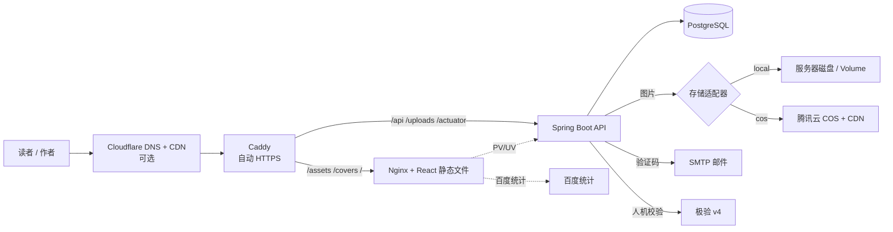
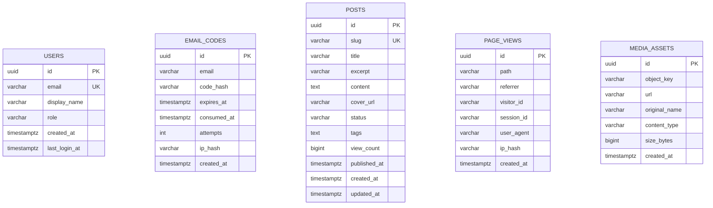
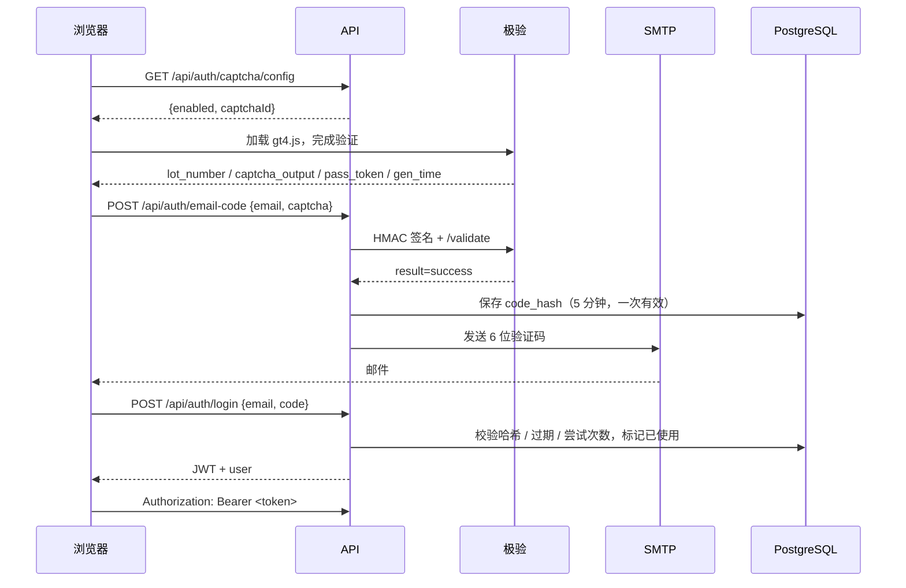
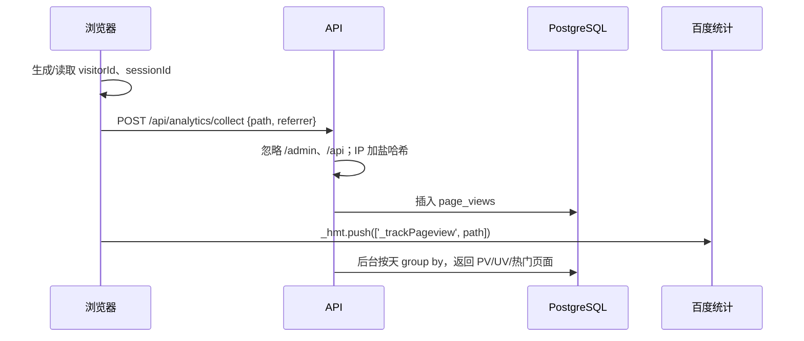

# 架构与数据流

## 全局视图



### 为什么是同源

生产环境里前端和 API 在同一个域名下：

- 不需要处理跨域预检和 Cookie 策略。
- Caddy 一张证书即可覆盖页面、接口和上传文件。
- CDN 规则更简单：静态资源走边缘缓存，`/api/*` 直接回源。

开发环境由 Vite 把 `/api`、`/uploads`、`/swagger-ui` 代理到 `127.0.0.1:8080`，所以前端代码里的请求路径在生产/开发完全一致。

## 代码分层

### API（`apps/api`）

```text
com.moyu.blog
├── auth        EmailCode → AuthService → JwtService
│               GeetestService（服务端校验，失败不发信）
├── post        Post 聚合 + 公开/后台两个 Controller
├── media       StorageService 接口
│               ├── LocalStorageService
│               └── CosStorageService
├── analytics   PageView 采集 + 原生 SQL 按天聚合
├── user        UserAccount / Role
├── config      Security、CORS、OpenAPI、示例数据、上传静态映射
└── common      ApiError、异常处理、客户端 IP
```

关键原则：

- **Controller 只做协议转换**，业务规则在 Service。
- **写操作有事务边界**；公开读接口使用只读事务。
- **外部依赖可替换**：邮件、存储、极验都通过接口 / 配置隔离。
- **数据库结构不交给 Hibernate 猜**：`ddl-auto=validate` + Flyway。

### Web（`apps/web`）

```text
src/
├── pages/         公开站点：Home / Post / About / NotFound
├── admin/         写作台：Login / Dashboard / Posts / Editor / Media
├── components/    Header、Footer、Markdown、Toast、GeetestGate
├── lib/           api、auth、types、format
└── styles/        单文件设计系统（CSS 变量 + 响应式）
```

后台按路由懒加载，公开首页首屏不会下载 Markdown 渲染器和后台代码。

## 数据模型



设计取舍：

- **标签用 JSON 文本**：最多 5 个，读多写少；避免为 MVP 引入多表关联。数据量大时再迁移到 `post_tags` + GIN。
- **验证码单独成表**：方便限流、审计和过期清理；不污染用户表。
- **阅读量在 `posts.view_count`**：文章详情读取时自增，简单直接。高并发时应改为 Redis 缓冲 + 定时回写，或事件表异步聚合。
- **PV 原始事件保留**：可以重算任意时间窗口；`ip_hash` 不可逆，避免存原始 IP。
- **媒体只存元数据**：文件在磁盘或 COS，URL 可直接给 CDN。

## 登录时序



安全细节：

- 验证码哈希 = `HMAC-SHA256(email + ":" + code, JWT_SECRET)`。
- 限流：同一邮箱 60 秒一次、每小时 5 次；错误最多 5 次。
- 管理员只由 `ADMIN_EMAILS` 决定，每次登录都会校正角色。
- JWT 使用 HS256，至少 32 字节密钥；没有 refresh token，7 天后重新登录。

## 埋点时序



- `visitorId` 存 `localStorage`，`sessionId` 存 `sessionStorage`。
- PV 是事件条数；UV 是 `count(distinct visitor_id)`。
- 百度统计通过 `VITE_BAIDU_TONGJI_ID` 注入，未配置时不加载脚本。

## 上传流程

```mermaid
flowchart LR
  UI[后台选择/拖拽文件] --> API[POST /api/admin/media]
  API --> V{类型 & 大小}
  V -->|不合法| E[400/413]
  V -->|合法| S[StorageService.store]
  S -->|local| L[data/uploads/YYYY/MM/uuid.ext]
  S -->|cos| C[COS PutObject]
  L --> R[/uploads/...]
  C --> R2[CDN 域名/对象键]
  R --> DB[(media_assets)]
  R2 --> DB
  DB --> UI
```

当前是**服务端中转上传**：实现简单、能统一校验类型与大小，适合 10MB 以内的封面和插图。海量/大文件场景应改为：

1. 后端签发 COS 预签名 PUT URL；
2. 浏览器直传 COS；
3. 回调后端落库。

这样应用服务器不承载文件流量。

## 部署拓扑

### 单机 Docker Compose

```text
Internet
  │ 80/443
Caddy ──► web (Nginx) ──► 静态文件
  └────► api (Spring Boot) ──► db (PostgreSQL)
                              └► uploads volume / COS
```

- Caddy 自动申请证书、自动续期、HTTP→HTTPS。
- 数据库不暴露公网端口。
- API 只暴露在 Docker 内网，公网只能通过 Caddy。
- 镜像来自 GHCR；服务器只负责拉取和重启。

### 零服务器 PaaS

```text
Cloudflare Pages ──► 静态前端（全球边缘）
        │ /api
        ▼
Render Web Service ──► Neon PostgreSQL
        └────────────► COS
```

- Cloudflare 负责 DNS/CDN/证书。
- Render 从 GitHub 构建 API Docker 镜像。
- Neon 提供托管 PostgreSQL。
- 免费额度和冷启动限制见部署文档。

## 可观测性

当前内置：

- `/actuator/health` 与 `/actuator/info`。
- 结构化容器日志（Caddy JSON、Spring Boot 默认日志）。
- 后台 PV/UV、热门页面、最近编辑。

生产建议补充：

- 接入云厂商日志服务（SLS / CLS）或 Grafana Loki。
- 对 5xx、健康检查失败、磁盘使用率、数据库连接数告警。
- 给 `/api/auth/email-code` 增加基于 Redis 的分布式限流（当前是数据库计数，单实例足够）。
- COS 开启 CDN 访问日志与用量告警，防止盗链流量。
